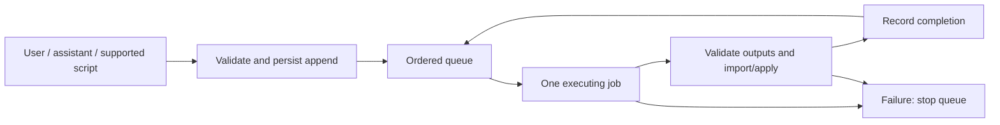
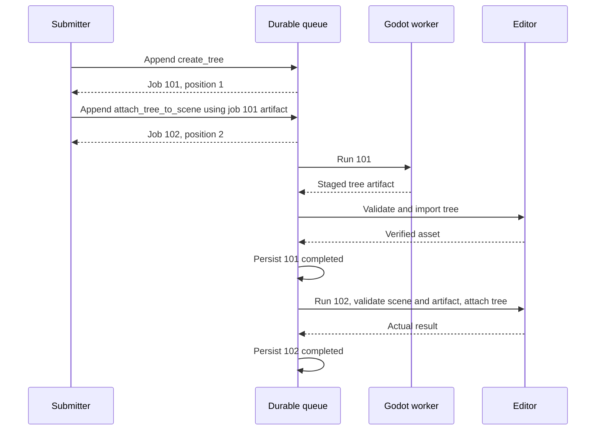

# Story 02 — FIFO queue diagrams

Design artifacts only. See the [plan](../implementation/02-job-manager.md) and [Jobs mockup](02-jobs-panel.html).

## Submission and execution

## Tree example

If job 101 fails, job 102 stays queued. Retry happens at the stopped position; it is not appended behind the attachment. A script may append further work, but it goes behind every job already accepted. The current script must finish without waiting for that work.

## Editor presentation

Jobs is a bottom panel: queue controls, ordered job list, selected-job details/logs/artifacts. Chat links to job IDs. There are no priority controls, parallel lanes, or dependency graphs in the first version. Pause prevents the next start; cancel stops the queue after resolving the current worker; completion includes required import/application.
