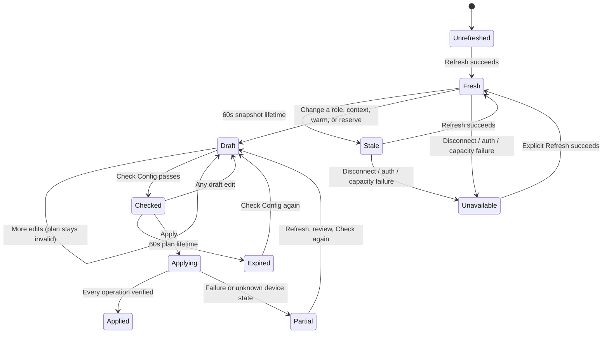
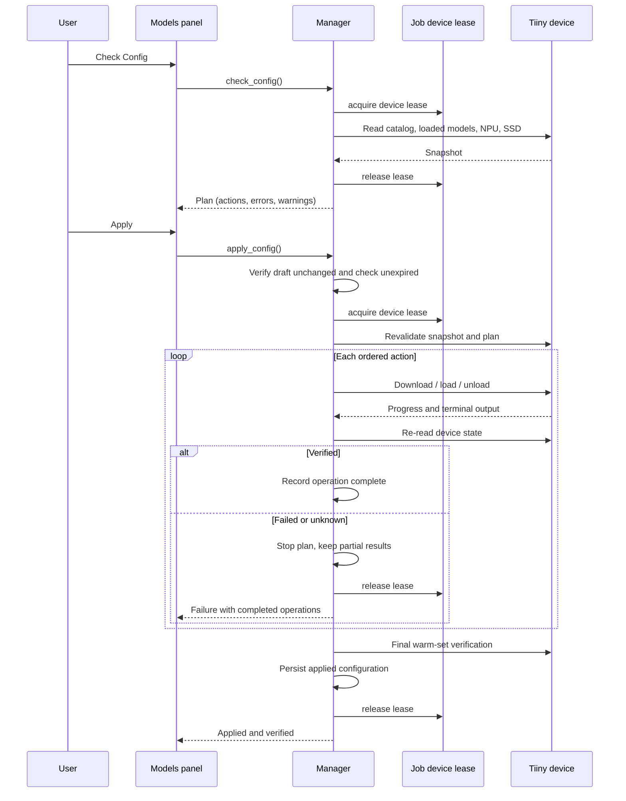
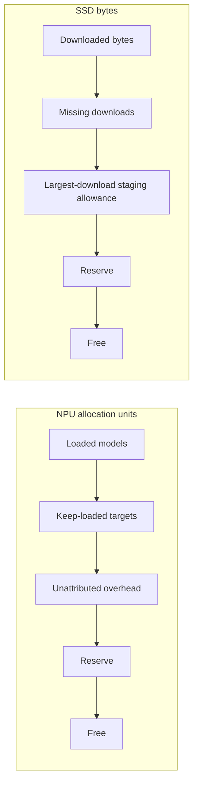
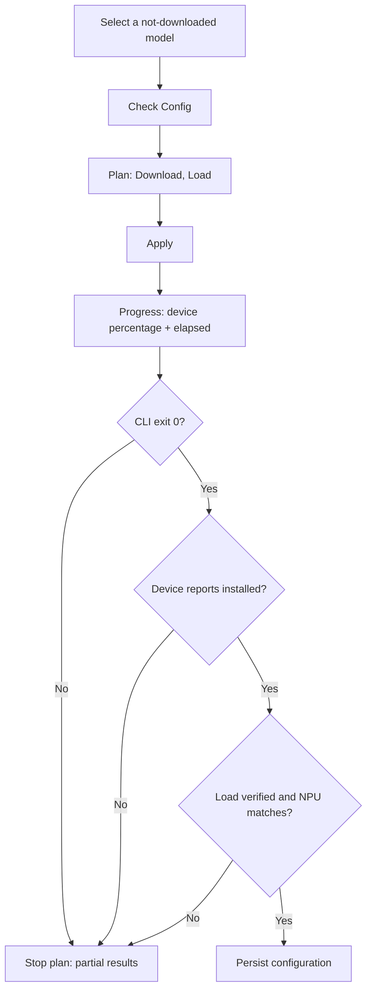

# Story 04 — Models screen diagrams

Design artifacts only. See the [implementation plan](../implementation/04-model-settings.md) and the [interactive mockup](04-model-settings.html).

## Staged configuration

A checked plan is never reused after a draft edit, expiry, connection change, or device-state change. Apply revalidates before the first operation.

## Apply sequence

## Capacity accounting

Projected values come from the pure planner. Unknown sizes or NPU units produce errors, never zero. NPU units are not physical RAM; SSD forecasts include one staging allowance.

## Role capability matrix

| Role | Accepted catalog type | Extra requirement | Empty-state explanation |
| --- | --- | --- | --- |
| Scripting | Text Generation, Image-Text-to-Text | `Tool Use` | "Choose a scripting model with Tool Use; none in this catalog." |
| Image generation | Text-to-Image | — | "No Text-to-Image model in this catalog." |
| Image to 3D | Image-to-3D | — | "No Image-to-3D model in this catalog." |
| Music | Music Generation | — | "No Music Generation model in this catalog." |
| Text to speech | Text-to-Speech | — | "No Text-to-Speech model in this catalog." |

No sound-effects role exists. A role never claims support the catalog does not declare.

## Freshness and error states

| State | Capacity display | Check Config | Apply | Primary action |
| --- | --- | --- | --- | --- |
| Fresh | Live values, age < 60s | Enabled | Per plan | Edit or Check |
| Stale | Dimmed historical values, `Stale · 78s` | Disabled | Disabled | Refresh |
| Unavailable | `—`, last known values marked historical | Disabled | Disabled | Refresh or fix Advanced |
| Auth failure | `—` | Disabled | Disabled | Fix API key, Refresh |
| Capacity failure | Live values with shortfall | Enabled, plan errors | Disabled | Adjust roles/reserves |
| Applying | Live, progress shown | Disabled | Disabled | Wait or Cancel current operation |
| Partial failure | Refreshed values | Enabled | Disabled until re-check | Review partial results, Refresh, Check |

## Download progress and completion

Progress alone never establishes completion. A stall warning is informational; verification is the gate.
