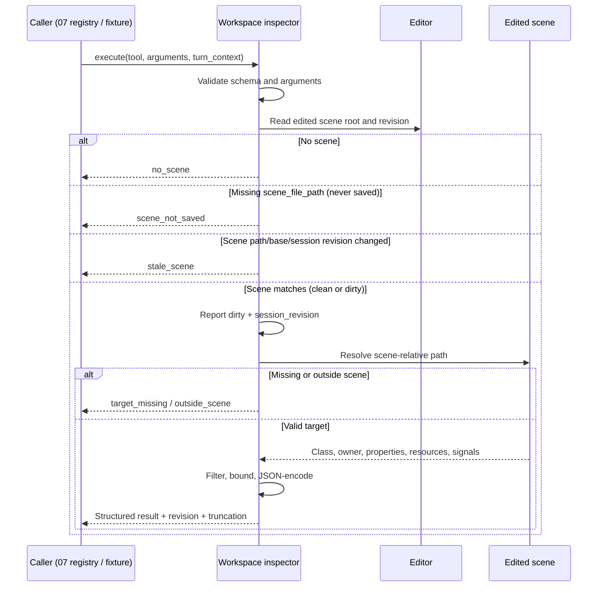
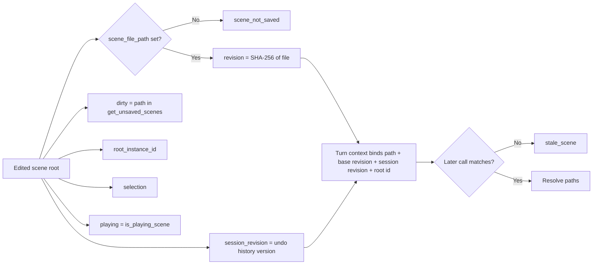
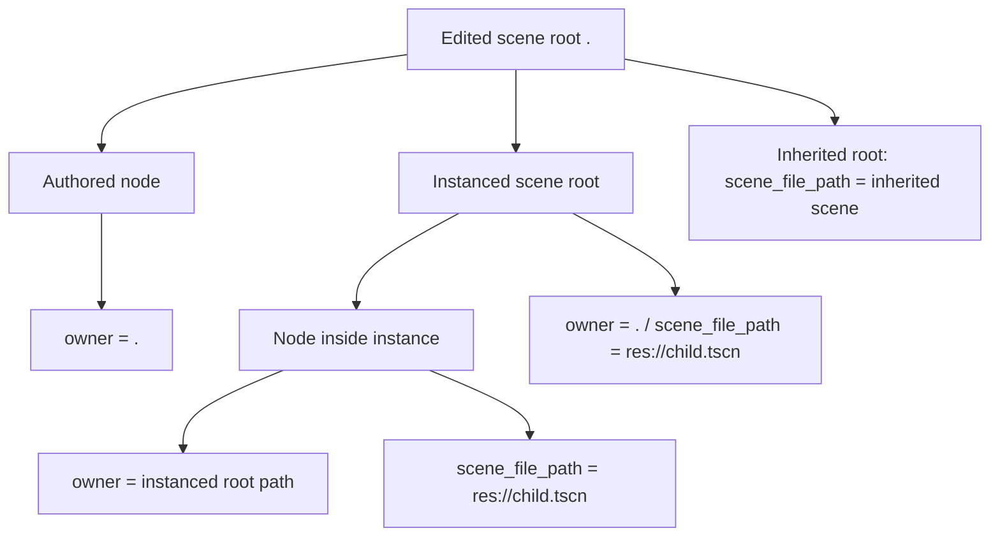
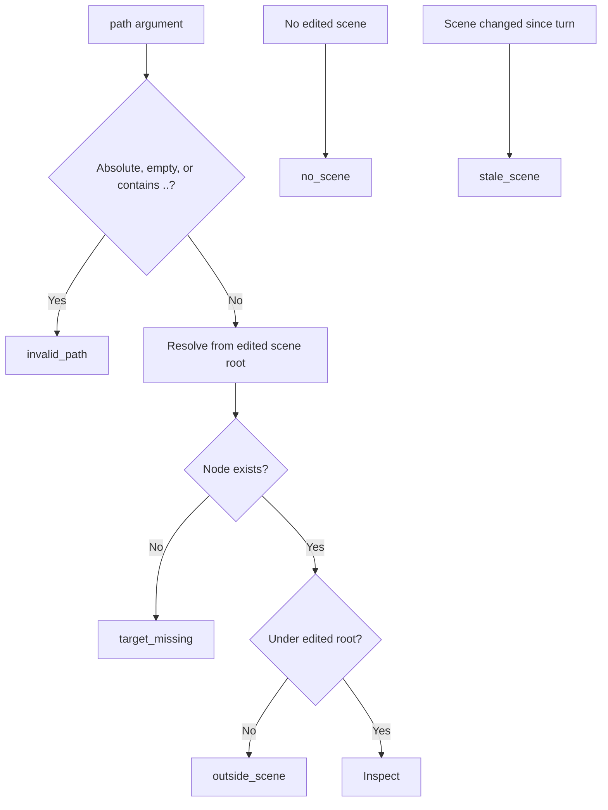
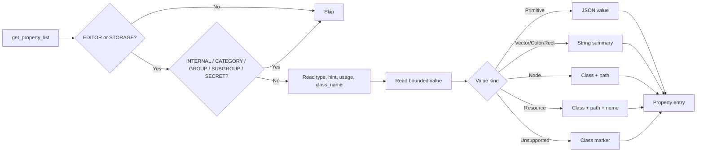
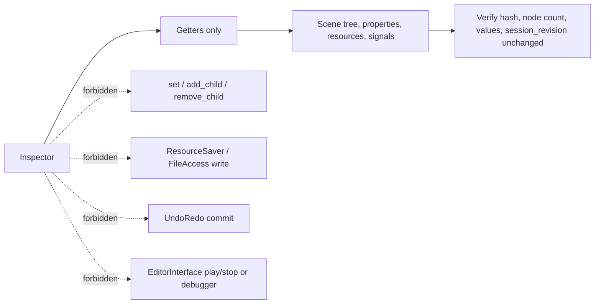

# Story 05 — workspace inspection diagrams

Design artifacts only. See the [implementation plan](../implementation/05-workspace-inspection.md) and the [story 07 tool contract](../implementation/07-orchestrator.md).

## Inspection call

## Scene identity and revision

The running remote scene is never used. `edited_scene_only` is always true; runtime/debugger values belong to story 12. A scene must be saved at least once; dirty scenes are inspectable and report `dirty` plus a session revision. Mutations require a clean scene.

## Node identity and ownership

`owner` and `scene_file_path` are separate. Paths are scene-relative and stable within the scene; instance IDs are session diagnostics only.

## Path resolution and errors

No selection is an empty state, not an error. A deleted target is never replaced by the current selection.

## Property filtering and encoding

Writability is a hint: not `READ_ONLY`, not a category/group, and a setter exists where known. Story 06 revalidates before writing.

## Bounds

| Surface | Default | Maximum | On limit |
| --- | --- | --- | --- |
| Scene tree depth | 4 | 8 | `truncated.depth` |
| Scene tree nodes | 200 | 500 | `truncated.nodes` |
| Node properties | 80 | 200 | `truncated.properties` |
| Resource properties | 60 | 120 | `truncated.properties` |
| Signal connections | 50 | 100 | `truncated.connections` |
| String value | 512 chars | — | Suffix marker |
| Array/dictionary | 64 entries | — | Suffix marker |
| Result JSON | — | 16 KiB (07 cap) | Truncate and flag |

## Read-only boundary

Story 05 reports the edited scene. It does not inspect the running remote scene, set breakpoints, or change editor state.
