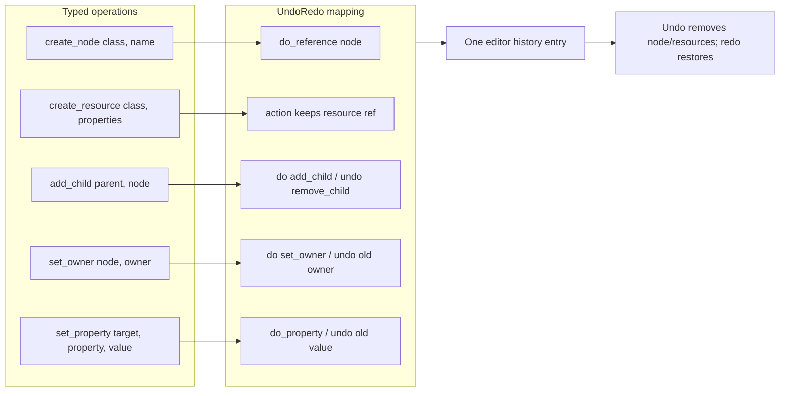
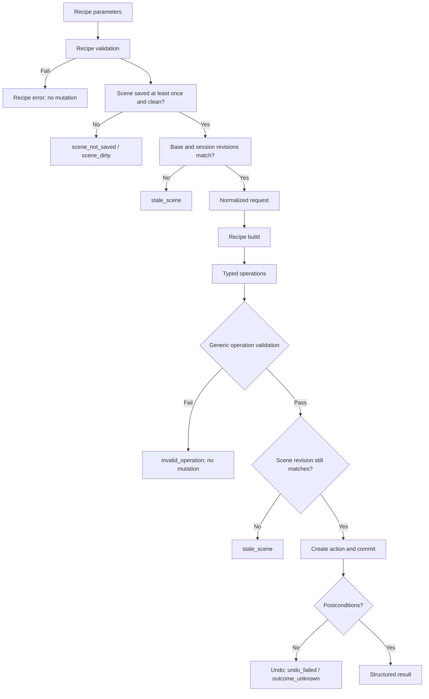
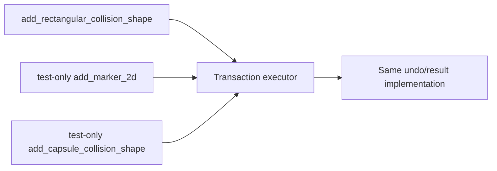
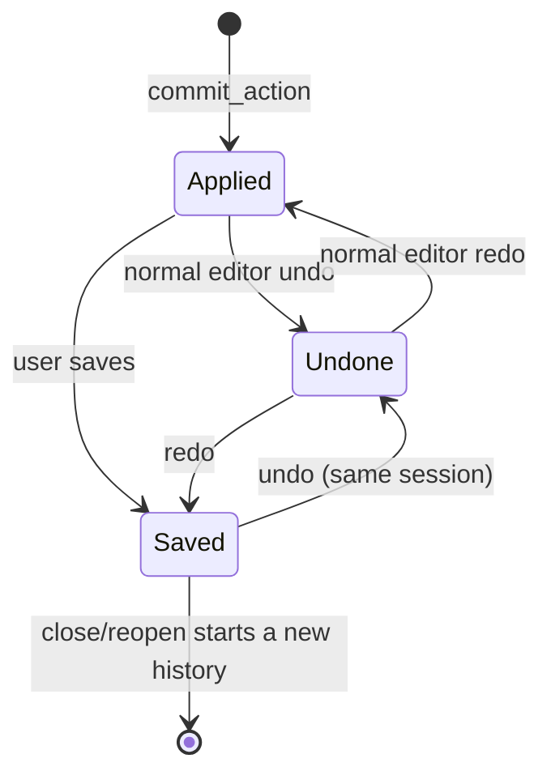

# Story 06 — typed scene edit diagrams

Design artifacts only. See the [implementation plan](../implementation/06-workspace-transactions.md), [story 05 inspection](../implementation/05-workspace-inspection.md), and [story 07 tool contract](../implementation/07-orchestrator.md).

## Recipe → transaction → undo

```mermaid
sequenceDiagram
    participant M as Model / fixture
    participant R as Recipe registry
    participant P as Recipe
    participant T as Transaction executor
    participant U as EditorUndoRedoManager
    participant S as Edited scene

    M->>R: recipe name + typed parameters
    R->>P: validate(parameters, scene context)
    alt Invalid
        P-->>R: error (class, property, dimensions, stale)
        R-->>M: error; no mutation
    else Valid
        P->>P: build typed operations
        P-->>T: create_node / create_resource / add_child / set_owner / set_property
        T->>T: Validate classes, properties, ownership, targets
        T->>U: create_action(scene history)
        T->>U: do/undo methods and properties; reference lifetimes
        T->>U: commit_action()
        U->>S: Apply do operations
        T->>S: Verify postconditions and one history entry
        alt Postcondition fails
            T->>U: Undo action
            T-->>M: undo_failed / outcome_unknown
        else Verified
            T-->>M: Structured result + affected + undo_group
        end
    end
```

The executor has no branch for `CollisionShape2D`. It only understands operation types and generic validation. Class-specific knowledge lives in the recipe.

## Recipe declaration

```text
recipe add_rectangular_collision_shape(parent_path, width, height, node_name?)
  validate:
    saved scene + matching revision
    parent exists, is CollisionObject2D, root-owned
    no existing direct CollisionShape2D
    width/height finite, > 0, bounded
    node name valid and unique (or auto-generated)
  build:
    create_node(CollisionShape2D, name)
    create_resource(RectangleShape2D, {size: (width, height)})
    add_child(parent, node)
    set_owner(node, root)
    set_property(node, "shape", resource)
```

A second recipe can create a `Marker2D`, a `CapsuleShape2D`, or another built-in class without touching the executor.

## Operation and undo mapping



Targets are scene paths or operation IDs. Values are literals or resource operation IDs. The model never supplies operation types, class names, or arbitrary property names.

## Validation pipeline



Generic checks: class exists and is instantiable and inherits Node/Resource; property exists, is writable, accepts the value; resource class is compatible; parent/owner relationships are valid; names are valid and unique; no cycles.

## Genericity test



The test recipes are not exposed to the model. They prove the executor is class-agnostic and that the collision-shape acceptance case is recipe data, not a special code path.

## Validation and no-partial evidence

| Surface | Before | After a failed recipe/operation |
| --- | --- | --- |
| Scene file hash | `sha256:A` | `sha256:A` |
| Node count | N | N |
| Parent child count | C | C |
| Resource objects | none created | none created |
| Undo history count | H | H |
| Scene dirty state | unchanged | unchanged |
| Selection | unchanged | unchanged |

A successful recipe changes exactly the planned nodes/resources, adds one history entry, and marks the scene dirty. Read-only tools remain available against the dirty session revision; further recipes require saving (`scene_dirty`).

## Undo state



The executor does not save and does not change selection. The readable action name identifies the recipe; the ledger token identifies the call. After a recipe, dirty inspection is allowed; mutation requires a save.
