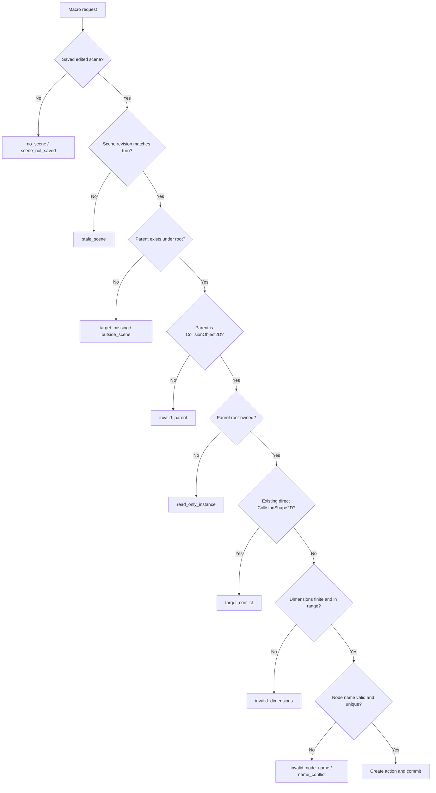
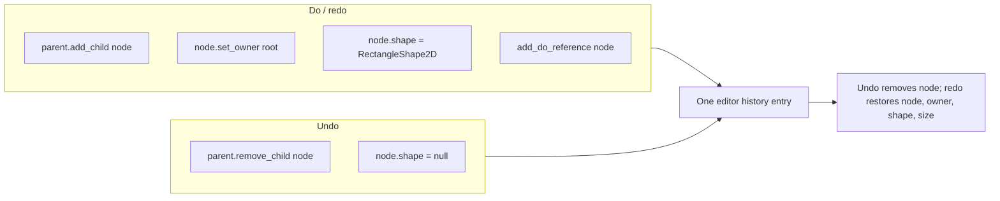
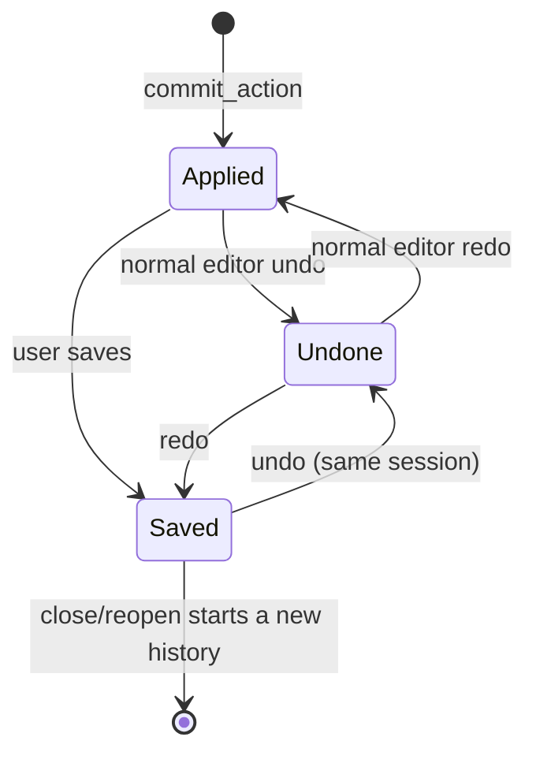
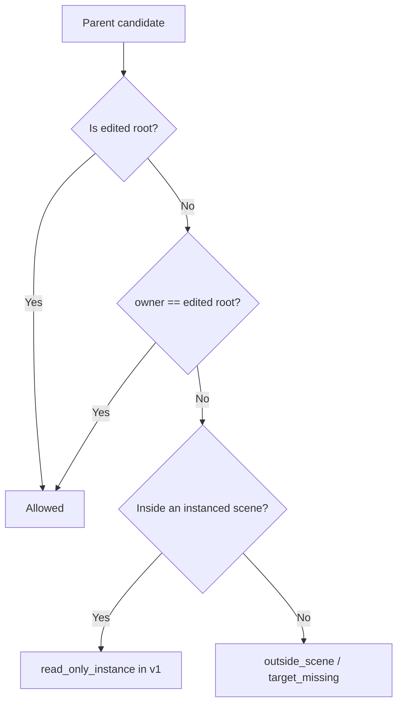

# Story 06 — typed scene edit diagrams

Design artifacts only. See the [implementation plan](../implementation/06-workspace-transactions.md), [story 05 inspection](../implementation/05-workspace-inspection.md), and [story 07 tool contract](../implementation/07-orchestrator.md).

## Macro call

```mermaid
sequenceDiagram
    participant M as Model / fixture
    participant T as Macro executor
    participant I as Story 05 inspector
    participant U as EditorUndoRedoManager
    participant S as Edited scene

    M->>T: add_rectangular_collision_shape(parent_path, 32, 48)
    T->>I: Resolve scene identity, revision, parent, ownership
    I-->>T: Scene context + parent facts
    T->>T: Validate class, ownership, conflict, dimensions, name
    alt Invalid or stale
        T-->>M: Error; no mutation
    else Valid
        T->>T: Create CollisionShape2D + RectangleShape2D (not yet in scene)
        T->>U: create_action(scene history)
        T->>U: do add_child, set_owner, set shape; do_reference(node)
        T->>U: undo remove_child, clear shape
        T->>U: commit_action()
        U->>S: Apply do methods
        T->>S: Verify node, owner, shape, size, one history entry
        alt Postcondition fails
            T->>U: Undo the action
            T-->>M: undo_failed or outcome_unknown
        else Verified
            T-->>M: Structured result + undo_group + dirty scene
        end
    end
```

## Validation gate



Everything before the final step creates nothing. Validation failure leaves node count, resource count, property values, and undo history unchanged.

## Undo action structure



The action is assigned to the edited scene's history via the root context. The node is not freed after commit; the undo reference owns its lifetime. The shape resource is kept by the do/undo property pair.

## Undo/redo state



The macro reports `dirty: true`; it never saves automatically. Reopening the scene loads the saved result but starts a new undo history.

## Ownership and parent rules



V1 accepts the edited root or nodes owned by the edited root. Editable-children support for instanced scenes is deferred.

## No-partial-change evidence

| Surface | Before | After a failed call |
| --- | --- | --- |
| Scene file hash | `sha256:A` | `sha256:A` |
| Node count | N | N |
| Parent child count | C | C |
| Direct CollisionShape2D count | 0 (or conflict) | unchanged |
| Resource objects | none created | none created |
| Undo history count | H | H |
| Scene dirty state | unchanged | unchanged |
| Selection | unchanged | unchanged |

The successful call changes exactly one parent's children by one node, creates one in-memory resource, adds one history entry, and marks the scene dirty.
