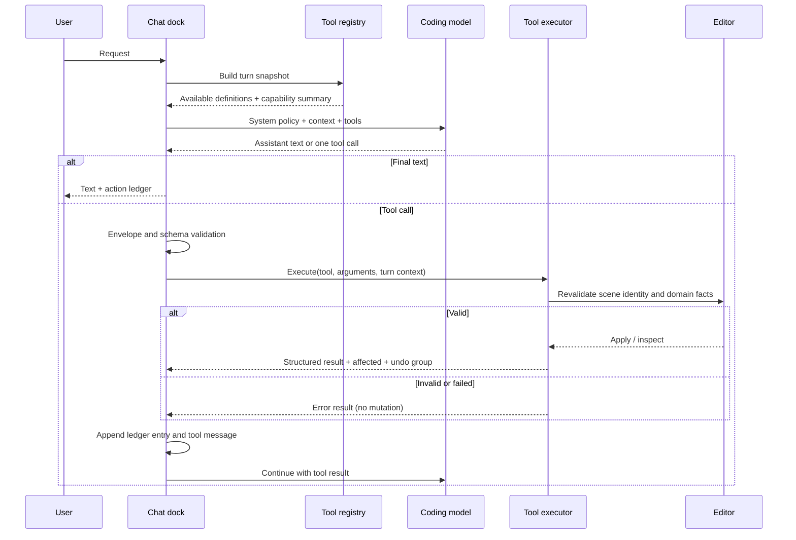
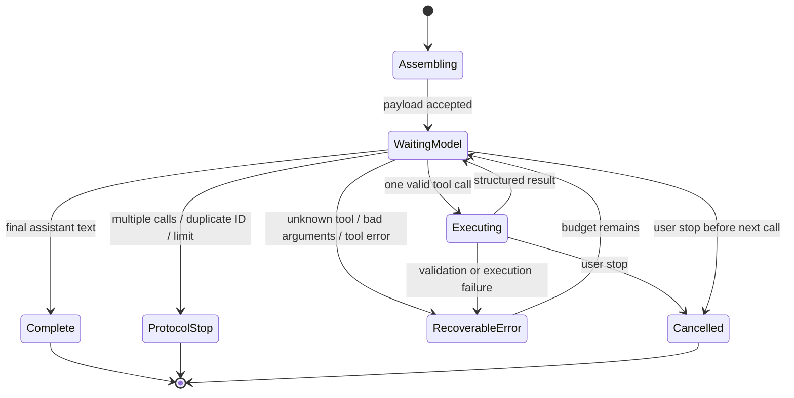
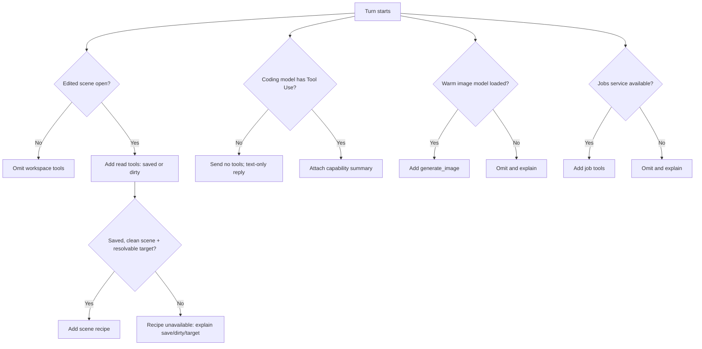
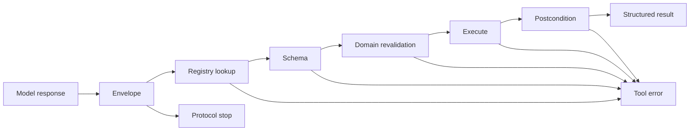
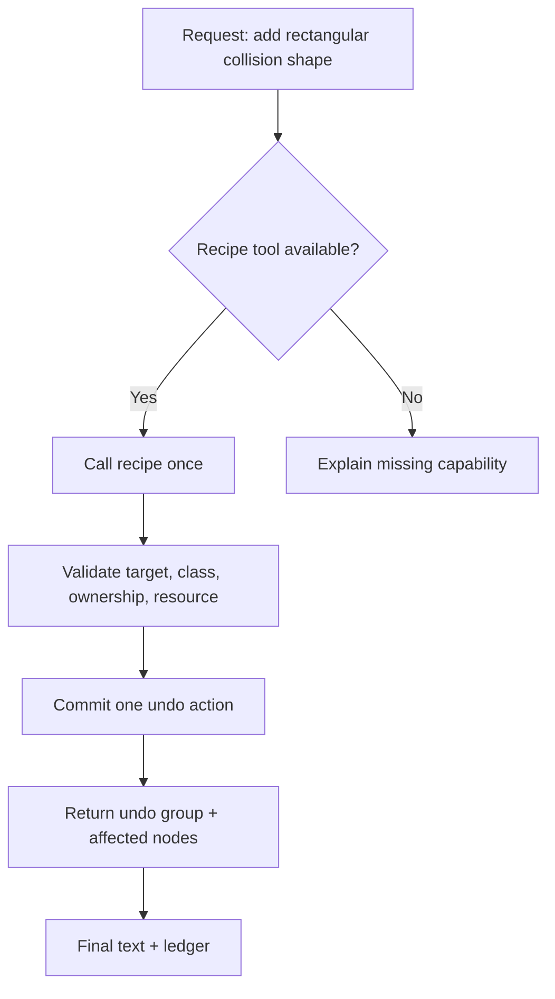

# Story 07 — tool orchestration diagrams

Design artifacts only. See the [implementation plan](../implementation/07-orchestrator.md).

## One turn

## Turn state

Every terminal path keeps the action ledger and a matching tool result for every executed call. The next turn starts from `Assembling` with no in-flight state.

## Registry and availability

Unavailable tools never appear in the HTTP `tools` array. The capability summary is the only place they are named.

## Validation pipeline

Envelope failures (multiple calls, duplicate ID, limit) stop the turn. Recoverable failures return a tool error and let the model correct within the budget. Domain validation always runs, even when the schema passes.

## Recipe-first

The recipe is one tool call and one undo action. Story 06 turns it into typed operations through a generic transaction executor; the orchestrator does not decompose it into primitive edits in 07.

## Ledger

| Field | Purpose |
| --- | --- |
| `turn` | Groups calls for the current request |
| `call` | Model call ID, echoed in the tool message |
| `tool` | Registry name |
| `ok` | Executor outcome, not model prose |
| `summary` | Human-readable result for chat |
| `affected` | Scene paths, node paths, resources |
| `undo_group` | Editor undo identity when applicable |
| `error` | Stable code and field, when failed |

The ledger is displayed with the final answer and retained for story 08's action history. Acceptance checks read the ledger and editor state, not the assistant's wording.
